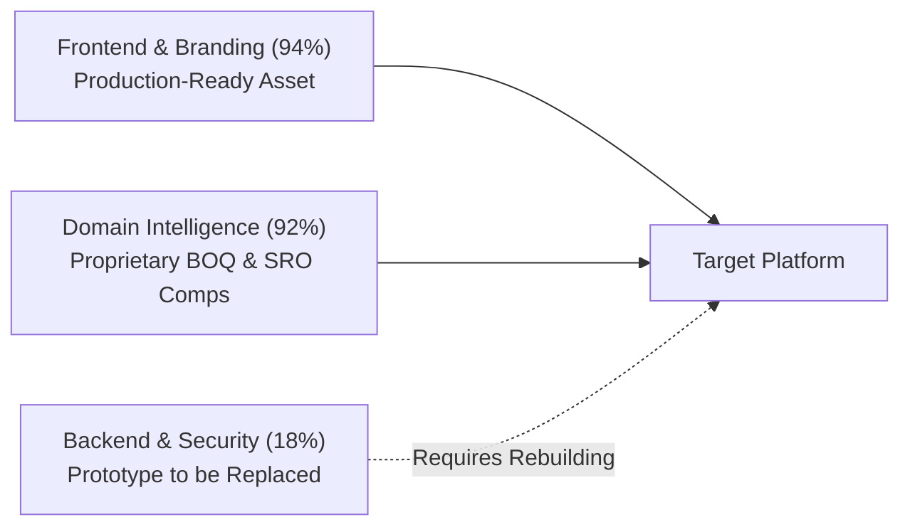
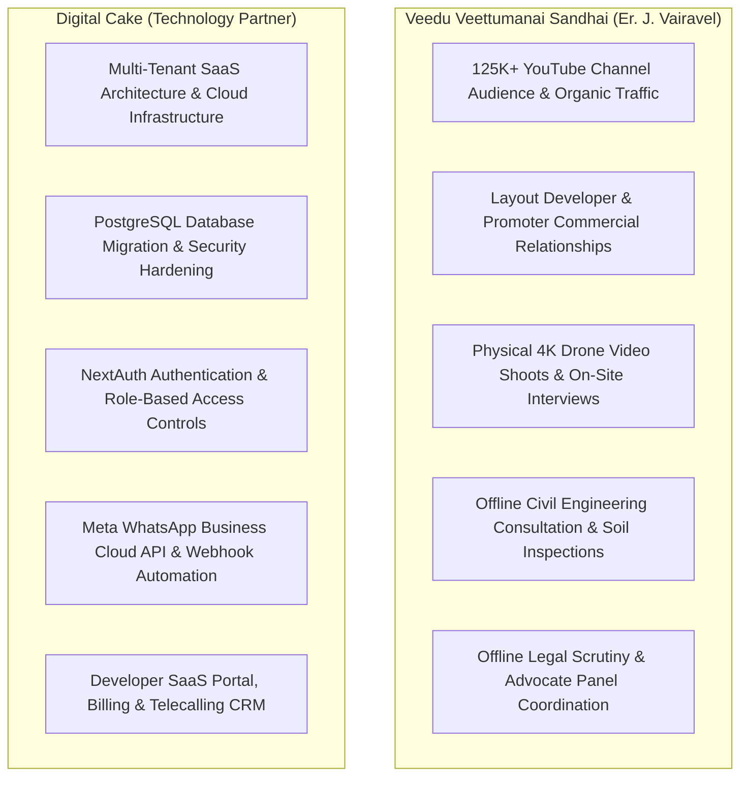

# EXECUTIVE DUE DILIGENCE SUMMARY

**Prepared For:** Leadership & Founders of **Digital Cake** and **Veedu Veettumanai Sandhai (VVMS)**  
**Subject:** Strategic Technology & Equity Partnership Codebase Evaluation  
**Date:** November 2026  
**Auditor:** Senior Software Architect & Technical Due Diligence Consultant  

---

## 1. THE STRATEGIC QUESTION
Should **Digital Cake** enter into an equity and technology partnership with **Veedu Veettumanai Sandhai (VVMS)**, how much technology already exists, what will it cost to transform into a commercial PropTech SaaS platform, and what are the major risks?

---

## 2. KEY AUDIT TAKEAWAYS (THE BOTTOM LINE)



1. **The Frontend Asset is High Value and Production-Ready:**  
   The consumer-facing web application (`veeduveettumanaisanthai.in`) is not a mere Figma prototype. It is a live, responsive Next.js 14 web application featuring bilingual English/Tamil toggling, interactive Turnkey Construction Cost Estimators, SRO Guideline vs. Market value comparison tables, and seamless YouTube video walkthrough integrations.
2. **The Backend is a Development Prototype (Not Production-Ready):**  
   The application currently runs on an embedded **SQLite database (`dev.db`)** and a single-password authentication scheme. Crucially, the internal API endpoints are currently unauthenticated, meaning customer leads and listings are not secure against external queries until patched.
3. **Multi-Tenancy is Currently Absent:**  
   The existing code is built as a single-business website for VVMS. It cannot currently onboard third-party layout developers or separate sales teams without a multi-tenant database restructuring.
4. **No Need to Rewrite From Scratch:**  
   Digital Cake can preserve **100% of the frontend user interface, branding, and domain calculation logic**, saving an estimated **35 to 45 person-days ($24,000 – $32,000 USD / ₹20–27 Lakhs INR)** in upfront development effort.

---

## 3. ASSET VALUATION & TECHNICAL REPLACEMENT COST

| Asset Component | Implementation State | Est. Person-Days Invested | Replacement Cost Baseline | Digital Cake Recommendation |
|---|---|---|---|---|
| **Mobile-First Responsive UI & Brand Theme** | Verified & Built (Next.js 14, Tailwind, Logo Palette) | ~12 Person-Days | $7,200 – $9,600 | **Keep & Reuse (100%)** |
| **Turnkey Construction Cost Estimator** | Verified & Tested (600–5000 sq.ft, 3 packages, 6-stage BOQ) | ~8 Person-Days | $4,800 – $6,400 | **Keep & Reuse (100%)** |
| **Land Intelligence & Micro-Market Comps** | Verified (8 Trichy corridors, SRO guideline spread, budget calc) | ~10 Person-Days | $6,000 – $8,000 | **Keep & Reuse (100%)** |
| **Real Estate Due Diligence Academy** | Verified (6-stage framework, 8 deadly traps, checklist) | ~6 Person-Days | $3,600 – $4,800 | **Keep & Reuse (100%)** |
| **Media & YouTube Importer Pipeline** | Verified (ID extraction, thumbnail cache, modal player) | ~4 Person-Days | $2,400 – $3,200 | **Keep & Reuse (100%)** |
| **Database & API Layer (Backend)** | Insecure Prototype (SQLite, no auth on APIs) | ~5 Person-Days | Deprecated Debt | **Rebuild on PostgreSQL (100%)** |
| **TOTALS** | | **40 ± 5 Person-Days** | **$24,000 – $32,000 USD** | **Substantial Reusable Foundation** |

---

## 4. PARTNERSHIP RESPONSIBILITY SPLIT (WHO OWNS WHAT)

To prevent scope creep and legal friction, the partnership agreement must clearly delineate responsibilities:



### Critical Boundaries for Digital Cake:
- **Refuse Liability for Disputed Titles:** Digital Cake builds the software; Er. J. Vairavel and VVMS panel advocates remain solely responsible for civil title opinions and legal accuracy.
- **Refuse Physical Media Tasks:** Video editing, camera crews, and drone flights must remain under VVMS operations.

---

## 5. 90-DAY MODERNIZATION ROADMAP & BUDGET

Digital Cake should execute an incremental 90-day modernization roadmap to transition VVMS into a scalable SaaS platform:

```
[Month 1: Foundation & Security]
├── 1. Patch API routes with NextAuth / JWT session verification
├── 2. Migrate from SQLite to managed PostgreSQL (Neon / Supabase)
├── 3. Implement Zod request validation on all endpoints
└── 4. Set up CI/CD pipeline with GitHub Actions

[Month 2: CRM & WhatsApp Automation]
├── 1. Integrate Meta WhatsApp Business Cloud API (Automated Drips)
├── 2. Build Lead Assignment Engine (Round-robin distribution to sales reps)
├── 3. Implement Phone De-duplication and Customer Activity History
└── 4. Launch Site Visit Scheduling Calendar

[Month 3: Developer SaaS & Monetization]
├── 1. Launch Promoter & Developer Self-Service Portal
├── 2. Integrate Razorpay / Cashfree for report purchases (₹199 / ₹3,999 / ₹4,999)
├── 3. Build Business Intelligence dashboard (Conversion rates & YouTube ROI)
└── 4. Conduct security penetration audit and commercial launch
```

### Estimated Cloud Infrastructure Budget (First 12 Months):
- **Managed PostgreSQL (Neon / Supabase Pro):** $25 – $50 / month
- **Edge Hosting (Vercel Pro):** $20 / month
- **Upstash Redis (Rate limiting & queues):** $10 – $30 / month
- **Meta WhatsApp Business API:** ~$50 – $150 / month (usage-based)
- **AWS S3 / Cloudflare R2 (Document storage):** $15 / month
- **Estimated Total Tech Run Cost:** **~$120 – $265 / month (₹10,000 – ₹22,000 INR / month)**

---

## 6. FINAL CTO RECOMMENDATION

### Verdict: **PROCEED WITH PARTNERSHIP (Subject to 3 Conditions)**

The technical assets and digital audience of Veedu Veettumanai Sandhai represent a rare, high-leverage opportunity in the Tamil Nadu real estate market:
- **High Organic Inbound:** The 125K+ subscriber channel drives genuine buyer intent that standard PropTech startups spend millions of rupees to acquire.
- **High Quality Front-of-House Code:** The frontend web application is clean, fast, and culturally tailored to Tamil home buyers.

### 3 Non-Negotiable Conditions Before Signing:
1. **Immediate Security Sprint:** Digital Cake must deploy the Day 1–15 security patch to protect the API routes and migrate to PostgreSQL before public promotion.
2. **Equity for Technology Investment:** Digital Cake's development effort (~60 to 75 person-days over the next 90 days) should be treated as equity contribution or structured technology service fee offset.
3. **Legal Disclaimer:** Ensure strict separation of liability between technology software services and real estate advisory/title scrutiny.

---
*For the complete code references, line-by-line vulnerability analysis, and architectural diagrams, refer to [CODEBASE_TECHNICAL_DUE_DILIGENCE.md](file:///Users/apple/Desktop/vvms/CODEBASE_TECHNICAL_DUE_DILIGENCE.md).*
